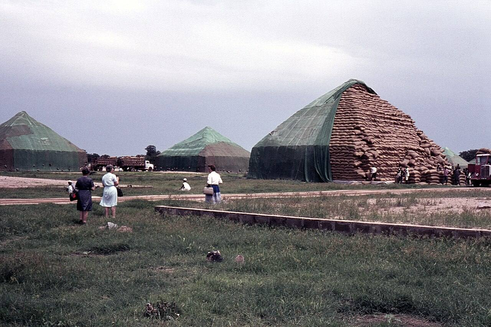
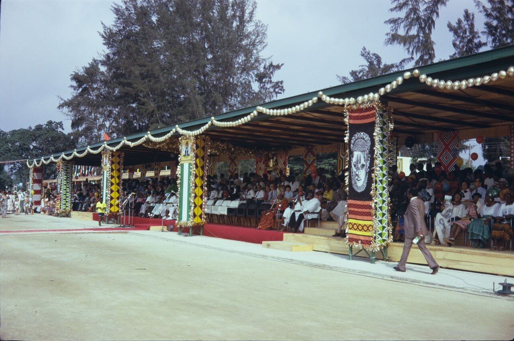
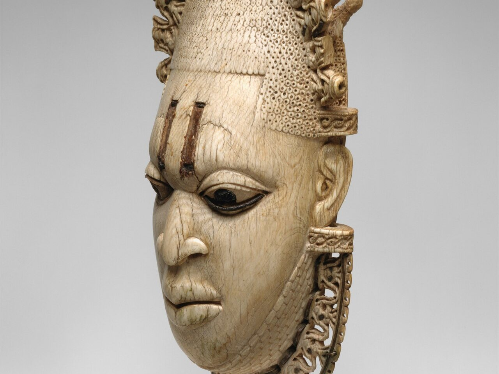
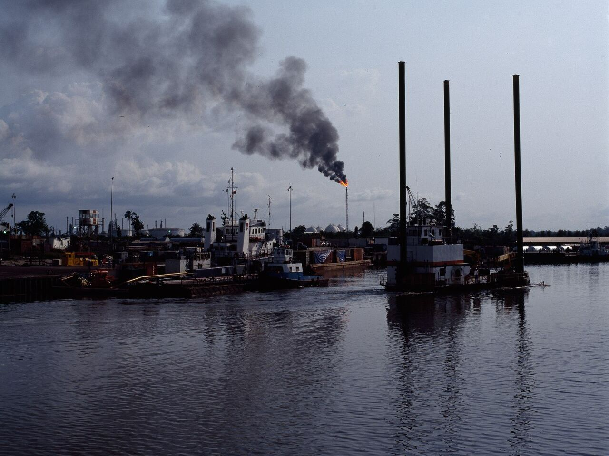
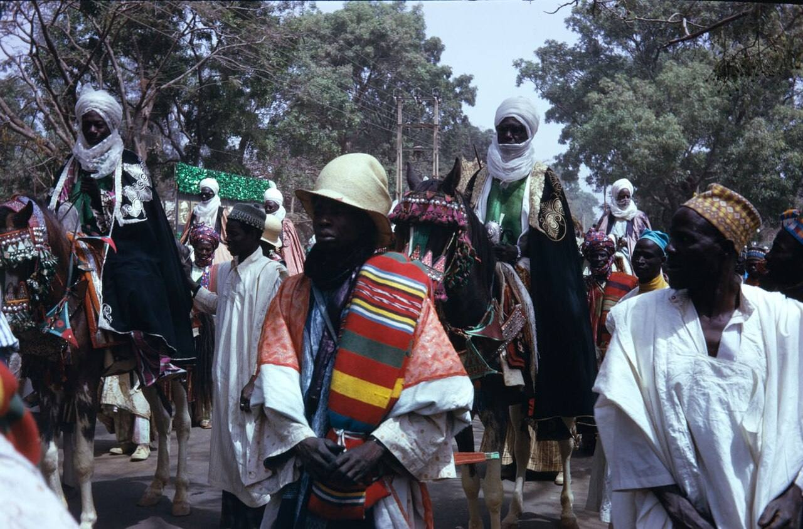

> *For she did not know that I gave her corn, and wine, and oil, and multiplied her silver and gold, which they prepared for Baal.* (Hosea 2:8)

On Saturday 15 January 1977, at the National Stadium in Surulere, a priest of Shango set the festival bowl alight before the Head of State and sixty thousand people, and the Second World Black and African Festival of Arts and Culture began. It ran for four weeks, to Saturday 12 February 1977, in Lagos and for its last days in Kaduna. Some seventeen thousand artists, dancers, scholars and musicians came from fifty-six countries. It was the largest gathering of Black people the world had seen, and the oil boom paid for all of it.

That month one naira bought about a dollar and fifty-five cents. Three years earlier Nigeria had lent the International Monetary Fund and the World Bank 360 million dollars between them, because it had reserves it could not spend fast enough. In June 2026 Nigeria's debts stood at 166.79 trillion naira, about 121 billion dollars, and a dollar cost 1,379 naira.

On 15 January 2027 it will be fifty years since the fire was lit, and on 12 February 2027 fifty years since the festival closed. The Federal Government's culture agency wants a hundred countries in Lagos to celebrate the golden jubilee, and a private revival of the festival has announced that it is coming home to Nigeria the same year. Nigeria's Pentecostal churches opposed FESTAC before it opened, as a plot to revive idol worship, and a line of preachers has called it the nation's root sin ever since.

This article sets the whole record in one place: what Nigeria had before the festival, what was done at it in public, what Scripture says about such acts, what happened to the nation afterwards, what the economists and the prophets each say about why, what is planned for 2027, why the nation's next elections have been moved to 16 January and 6 February 2027, inside those same four weeks, and what the church should do with the year of jubilee.

*Cover: a decorated canoe at the FESTAC 77 regatta on the Lagos lagoon, 1977. Photograph by Helinä Rautavaara, Helinä Rautavaara Museum, Espoo, CC BY 2.0, via Wikimedia Commons.*

## Before: the land fed the nation and lent to the world

Nigeria at independence in 1960 was an agricultural power. Agriculture produced more than six tenths of national output and about seven tenths of export earnings. The country was the world's largest exporter of palm oil and palm kernels into the mid-1960s, with roughly four tenths of world trade, and the world's largest exporter of groundnuts; the sacks of the northern harvest were stacked into the pyramids of Kano that stood as tall as houses. It was the second largest cocoa producer, behind Ghana. Each region paid its own way from its own crops. External debt in 1960 was about 150 million dollars.

*The groundnut pyramids of Kano in 1965, when Nigeria was the world's largest exporter of groundnuts. Photograph by David Pirmann, CC BY 2.0, via Wikimedia Commons.*

Then came oil. When the Arab producers quadrupled the price in late 1973, the federal revenue leapt in a year. The naira had been born on 1 January 1973 at about 0.66 to the dollar, so that one naira was worth a dollar and fifty cents; it was pegged there and it held, and by 1980 it was stronger still, at 0.55, a dollar and eighty cents. A Nigerian student in London in those years was rich.

In 1974 the IMF, trying to carry the oil-importing countries through the shock, borrowed from the countries that had the money, and Nigeria was one of them. The permanent secretary Abubakar Alhaji signed for 120 million dollars to the Fund's Oil Facility; the same year Nigeria lent the World Bank 240 million. For most of the period from 1973 to 1982 Nigeria stood on the creditor side of the IMF's books. The head of state, General Gowon, said in words every Nigerian over sixty can quote that money was not the country's problem but how to spend it.

The spending followed. The Udoji awards of 1975 doubled public salaries with arrears. The same year the government ordered between sixteen and twenty million tonnes of cement for a port that could unload about a million tonnes a year, and four hundred ships sat at anchor off Lagos for months being paid to wait: the cement armada. And from 1975 to 1977 the nation built the National Theatre at Iganmu and FESTAC Town, and staged the festival itself, at a cost usually put at around 400 million dollars and by some estimates far more. On the eve of FESTAC the external debt was about three billion dollars, some six per cent of national output, and Nigeria owed nobody anything it could not pay.

## What was done at FESTAC, in public

The facts below are not in dispute. They come from the festival's own records, from the historians who have studied it and from the people who were there.

*The grandstand at the Grand Durbar in Kaduna, February 1977, hung with banners of the festival emblem, the Queen Idia mask. Photograph by Helinä Rautavaara, Helinä Rautavaara Museum, CC BY 2.0, via Wikimedia Commons.*

- **The emblem** was a copy of the sixteenth-century ivory pendant mask of Queen Idia of Benin, carved for the festival by Erhabor Emokpae after the British Museum refused to lend the original looted in 1897. In Benin court tradition the mask is a royal and ancestral image. It went onto banners, programmes, coins and buses, and became the face of the nation for a month.
- **The opening** at the National Stadium on 15 January began with a twenty-one gun salute and the release of a thousand pigeons. Then a Shango priest, a priest of the Yoruba god of thunder, lit the festival flame. General Olusegun Obasanjo, the military head of state, presided.
- **The colloquium**, which the organisers called the heart of the festival, opened with the festival's Grand Patron pouring a libation of water and alcohol to the gods and the ancestors, with the Oba of Lagos among the guests at the high table. Its working groups included one on "Black civilisation and religion", and the Vatican sent observers.
- **The regatta** on the Lagos lagoon brought the war canoes and masquerades of the riverine peoples, and **the Grand Durbar** at Kaduna in the festival's last days put the Sultan of Sokoto and the emirs on the same field as three and a half thousand horsemen, camel riders from Katsina and Bori dancers from Zaria. Bori is the Hausa cult of spirit possession.
- **The exhibitions** showed two thousand years of Nigerian art: the Nok terracottas, the Ife heads, Igbo-Ukwu bronzes and the Benin court pieces, with the carvings of fifty nations beside them.

Nobody hid any of this. It was the point. FESTAC was conceived, from its first edition in Dakar in 1966 under Léopold Senghor's philosophy of Négritude, as a return to Africa's own spiritual sources after colonialism. Lagos in 1977 was that return on the grandest scale, and religion was written into the programme beside music, dance and literature.

*One of the sixteenth-century ivory pendant masks of Queen Idia of Benin, sister to the British Museum piece that the FESTAC emblem copied. Metropolitan Museum of Art, public domain.*

## What Scripture says about such acts

A Christian does not have to decide whether every dancer was a devotee or every carving an idol. The public acts are enough to weigh.

Lighting a nation's festival fire by the hand of a priest of Shango is not neutral. "There shall not be found among you any one that maketh his son or his daughter to pass through the fire, or that useth divination, or an enchanter, or a witch, or a charmer, or a consulter with familiar spirits" (Deuteronomy 18:10–11). Pouring drink to the ancestors is contact with the dead, which the same passage forbids and which the gospel closes: "There is one God, and one mediator between God and men, the man Christ Jesus" (1 Timothy 2:5). Paul does not treat the gods of the nations as harmless art: "The things which the Gentiles sacrifice, they sacrifice to devils, and not to God: and I would not that ye should have fellowship with devils" (1 Corinthians 10:20). And Scripture does not grade images by the quality of the ivory: "The idols of the heathen are silver and gold, the work of men's hands" (Psalm 135:15).

Culture is not the issue. Bezaleel was filled with the Spirit of God to carve and cast for the tabernacle (Exodus 31:1–5), and the gospel has made every African language and every drum fit for the praise of Christ. The question Scripture asks of any object or rite is whom it serves. A masquerade in the town it comes from is not a costume. A libation is not hospitality. When a head of state performs them on behalf of a nation, the nation has, in the Bible's terms, been presented to those spirits. That is why Israel's kings were judged not for what their people did in private but for what they did at the public altars, and why Josiah's reform began with the high places the kings before him had built (2 Kings 23).

## After: the turn

*A gas flare at Nembe Creek in the Niger Delta, 1993. By 1988 oil was 87 per cent of Nigeria's exports and three quarters of the government's revenue. Photograph by Sara Leigh Lewis, CC BY-SA 4.0, via Wikimedia Commons.*

The year after FESTAC, Nigeria went to the Eurodollar market for the first time. The one-billion-dollar "jumbo loan" signed in January 1978, for the steel projects, was followed within the year by another of 750 million. The IMF's own historians date the change in Nigeria's borrowing from that year. Commercial loans, almost nothing in 1977, were two thirds of the debt by 1982.

Oil prices rose again in 1979 and 1980 and the Second Republic spent as if they would rise forever. Then they fell. From 1981 the oil glut cut the government's revenue by more than half; by 1982 the external debt was around 18.6 billion dollars and the Shagari government passed an austerity law. In 1983 the soldiers came back. By 1985 the debt was 19 billion and Nigeria could not pay it.

In 1986 the Babangida government took the structural adjustment programme the IMF had been pressing on it and let the naira float. It went from under one naira to the dollar in May 1986 to two by the end of the year, four by 1988 and twenty-two by 1993. It traded at over eighty on the street in the Abacha years, was 92 to the dollar at the return to democracy in 1999, around 150 by 2010, 305 in 2016, and after the float of 2023 it passed 1,500. The Central Bank's official rate on 30 June 2026 was 1,379. A naira that bought a dollar and a half in 1977 buys about seven hundredths of a cent now.

Income fell with it. Measured in current dollars, output per Nigerian dropped from about 911 dollars in 1980 to about 262 in 1986; at purchasing power it was forty per cent lower in 2000 than in 1980. A generation grew up poorer than its parents in a country pumping two million barrels of oil a day.

The debt did not go away. By 2004 Nigeria owed 36 billion dollars abroad, 31 billion of it to the Paris Club of rich governments, most of it interest and penalties on loans taken in the years after FESTAC. In 2005 Ngozi Okonjo-Iweala negotiated the write-off of 18 billion in return for 12 billion in cash, and in April 2006 the books were cleared. Within fifteen years the country had borrowed its way back: external debt was 43 billion dollars in 2023 and 54.5 billion in June 2026, and total public debt, domestic and foreign, stood at 166.79 trillion naira. A country that lent the World Bank 240 million dollars in 1974 is now one of its largest borrowers, owing it more than twenty billion.

## What the economists say, and what the prophets say

None of this needs a spirit to explain it, and the economists have explained it. A country that lets oil pay for everything stops farming and manufacturing; by 1988 oil was 87 per cent of exports and three quarters of the government's revenue, and the palm oil and groundnut trades had collapsed. A currency held artificially strong by oil dollars makes imports cheap and the farmer's crop worthless. Military governments with no need to tax their people spent without accounting. Loans taken in boom years at floating rates came due in bust years at double the interest. Corruption took its share at every stage. This is the textbook history of the resource curse, and Nigeria is its textbook case. All of that is true.

It is also exactly what the prophets said happens. Hosea watched a nation enjoy a boom and misread it: "For she did not know that I gave her corn, and wine, and oil, and multiplied her silver and gold, which they prepared for Baal" (Hosea 2:8). Israel's oil, in the prophet's own word, came from God, and Israel spent it on the gods of the land. The judgment that followed was not a thunderbolt. It was economic: "Therefore will I return, and take away my corn in the time thereof, and my wine in the season thereof" (2:9). Moses had warned of the mechanism before Israel entered the land: "Thou say in thine heart, My power and the might of mine hand hath gotten me this wealth... And it shall be, if thou do at all forget the LORD thy God, and walk after other gods, and serve them, and worship them, I testify against you this day that ye shall surely perish" (Deuteronomy 8:17–19). Haggai described a boom economy that could not hold its money: "He that earneth wages earneth wages to put it into a bag with holes" (Haggai 1:6). Every Nigerian who has watched a salary vanish between the bank and the market knows the bag with holes.

In January and February 1977, at the height of the wealth God had given it, Nigeria's government staged a festival whose fire was lit by a priest of Shango and whose colloquium began with a libation to the ancestors and the gods, and paid for it with the oil money. Hosea's sentence fits without a word changed: silver and gold, multiplied, prepared for Baal. The year after, the borrowing began. Four years after, the fall.

## The church's objection, from 1977 to today

The Pentecostal churches, then a small and despised minority, said this before the festival opened. Scholars of the period record that they organised to protest FESTAC "on the grounds that it was a plot from the devil to revitalize idol worship", and that they have kept "a consistently contemptuous reception" of it ever since. In 1977 they were ignored. Then came the revival of the 1980s, and the scattered fellowships of 1977 became the largest congregations on earth.

The objection has never gone away. In 2013 Prophet Chris Okafor said the nation's troubles could be traced to 1977, when it was "handed over to idols", and called for a national cleansing. In 2018 Evangelist Felix Adunpe said Nigeria "is still wallowing under demonic powers following hosting of FESTAC '77", that changing governments would not fix what prayer had not, and called a seven-day crusade at Ori-Oke Ikoyi in Osun State for the nation's deliverance. In 2019 Pastor David Adepoju of New Life Eternal Church called FESTAC "the number one sin of Nigeria against God" and said that "until there is national repentance of FESTAC 77 there will be no solution to the country's problem."

The men who ran the festival reject the charge. At the fortieth anniversary in November 2017, Obasanjo, by then a Baptist elder with a doctorate in theology, said FESTAC was staged "to show the world" the culture of Black and African peoples, and that "it is not a fetish celebration or a fetish festival." Scholars of Nigerian culture call the idolatry charge misguided and the festival a landmark of the nation's confidence.

## Coincidence or consequence?

Here honesty is owed in both directions. Nigeria's troubles did not start in 1977: the first coups came in 1966, the civil war killed more than a million people between 1967 and 1970, and the rot was visible in the cement armada two years before the festival. FESTAC did not cause the oil glut of 1981. Jesus refused to let his disciples read the tower of Siloam as a verdict on the eighteen it killed (Luke 13:4–5), and the church has been warned against the easy prophecy that explains every misfortune by one sin.

But the Bible does not ask us to choose between the mechanism and the meaning. Hosea knew perfectly well that drought and Assyria were the instruments; he still said it was God taking back his corn. What a nation does with God's gifts at the height of them is, in Scripture, the thing God watches most closely. Manasseh's idolatry in Jerusalem was still being answered two generations after he died (2 Kings 23:26). Daniel, who had committed none of Israel's sins, confessed them as his own: "We have sinned, and have committed iniquity... O Lord, hear; O Lord, forgive" (Daniel 9:5, 19). Nigeria did not merely waste its boom. It dedicated the boom, publicly, through its head of state, to spirits that are not God. The believer who says that mattered is not being superstitious. He is reading Hosea.

The truth the church can stand on is narrower than the slogan and stronger than the denial. Nigeria's leaders did, in public and in the nation's name, honour spirits that are not God. Scripture calls that sin, whatever its cultural dress. Sin that has never been confessed stands until it is. That is not a curse to be feared. It is an invitation to be answered.

## 2027: the jubilee being planned

The fiftieth anniversary falls on Friday 15 January 2027, and the same four weeks run to Friday 12 February 2027. Two sets of plans are already in motion.

*Horsemen at the Grand Durbar, Kaduna, February 1977. The plans for 2027 promise the same spectacle. Photograph by Helinä Rautavaara, Helinä Rautavaara Museum, CC BY 2.0, via Wikimedia Commons.*

The Federal Government's Centre for Black and African Arts and Civilisation, the agency created to keep FESTAC's legacy, announced on 2 July 2026 in Lagos that it is targeting the participation of about a hundred countries in the golden jubilee. Its director-general, Aisha Augie, said the anniversary would "celebrate Africa's shared cultural heritage" and bring governments, cultural institutions and the diaspora together. She spoke at a dialogue on the Eyo masquerade as an instrument of soft power, where the head of the National Council for Arts and Culture, Obi Asika, said festivals and indigenous knowledge should be treated as intellectual property that creates wealth.

Separately, a private revival called FESTAC Africa, chaired by the engineer Yinka Abioye, has held an edition every year since 2022, in Zanzibar, Arusha, Kisumu and, from 21 to 27 September 2025, Accra. On 25 May 2026, Africa Day, at Mandela Park Resort on the old FESTAC site, Abioye flagged off a countdown and announced that FESTAC Africa 2027 will return to Nigeria, with Asaba and Delta State leading the anniversary activities. He called it "not simply the return of a festival, but the revival of a continental vision", and listed endorsements from UNESCO, AUDA-NEPAD, the African Continental Free Trade Area and the Wole Soyinka Foundation. Dakar hosts the 2026 edition in October, sixty years after Senghor's first festival.

Both plans speak of the creative economy, tourism and diplomacy. Neither, so far, has said anything about the fire, the libation or the mask. The church should not expect them to. It should decide what it will do with the same year.

## The lease, the jubilee, and two elections inside the lease's last month

I will say plainly what I believe, and then set out the facts that any reader can check.

I believe that at FESTAC 77 Nigeria was leased to darkness. Not sold outright, because "the earth is the LORD's, and the fulness thereof" (Psalm 24:1) and no head of state can sign away what belongs to God. But leased, the way land was leased in Israel. The law of Moses would not allow land to be sold for ever: "The land shall not be sold for ever: for the land is mine; for ye are strangers and sojourners with me" (Leviticus 25:23). A man in hard times could part with his inheritance, and the buyer held it and took its harvests, but only until the fiftieth year. Then the trumpet sounded and "ye shall return every man unto his possession" (Leviticus 25:10, 13). What was given away under pressure came back to its rightful owner by law, without a kobo paid, because the owner's claim had never lapsed. That is the mystery of jubilee: a lease that darkness takes in a nation's boom has a term written into it by God, and the term is fifty years.

The lease was not signed in a day. It was taken over the whole festival, from the Shango fire at Surulere on Saturday 15 January 1977 to the Durbar at Kaduna that closed it on Saturday 12 February 1977: four weeks of rites, libations, masquerades and the mask held up before the nations. So its term runs for fifty years from those dates, and it expires when the last of them has passed: on 12 February 2027. Until then the powers that took the lease hold it with a legitimacy that Scripture itself recognises. Satan is a legalist. He stood at Joshua the high priest's right hand with a case to make (Zechariah 3:1), he asked for Job and was given him (Job 1:12), and Paul warns believers not to "give place to the devil" (Ephesians 4:27), the word for place, topos, meaning a foothold or an opening he is entitled to use. A nation's leaders gave him place in 1977, publicly and in the nation's name, and for fifty years he has held Nigeria on that ground. From 13 February 2027 the ground is gone. Any hold on Nigeria after that date is illegitimate, a squatter's hold, and a squatter is removed not by negotiation but by the owner's authority.

Here is the fact that made me write this section. Under the Electoral Act of 2022, Nigeria's presidential and National Assembly elections were fixed for Saturday 20 February 2027, eight days after the lease expires, with the governorship elections on 6 March. On 18 February 2026 President Tinubu signed the Electoral Act 2026, and on 26 February the Independent National Electoral Commission brought the elections forward: the presidential and National Assembly vote to Saturday 16 January 2027, the day after the fiftieth anniversary of the fire, and the governorship and state assembly vote to Saturday 6 February 2027, six days before the lease ends. Both now fall inside the lease's final month. The commission's stated reason was that the new Act "introduced adjustments to statutory timelines governing pre-election and electoral activities". Before that, Muslim groups and former Vice President Atiku Abubakar had complained that 20 February would fall in Ramadan. Those are the reasons on the record, and I report them. No presidential election has been held in January since the return to democracy in 1999.

I believe those reasons are excuses, and that the real reason is spiritual. The men who moved the dates may have had nothing in their minds but Ramadan and the lawyers' calendar; that is how the rulers of this darkness usually work, through men who do not know whose errand they are running, for "we wrestle not against flesh and blood, but against principalities, against powers, against the rulers of the darkness of this world" (Ephesians 6:12). But the powers know the terms of their own lease to the day. An election on 20 February would have been held on ground they no longer had any right to stand on. An election on 16 January, and another on 6 February, is held while their lease is still valid and their standing still lawful. They have moved Nigeria's choice of its next rulers into the last weeks in which they can lawfully influence it, so that the government of the next four years is chosen under the old lease rather than the new freedom.

That is not a reason for fear. It is a reason to understand the hour, and the hour has a second half. Whoever is elected on 16 January will not take office until 29 May 2027, more than three months after the lease has expired. They will be sworn in on ground that has already returned to its owner. The tenants may be chosen under the old lease; they will govern in a Nigeria that is no longer leased, and the church will have every legal right in heaven to pray them into the hand of God or out of office. "The LORD hath prepared his throne in the heavens; and his kingdom ruleth over all" (Psalm 103:19). The jubilee was never in the gift of INEC. But the dates tell the church what to pray for before 16 January, what to contend for between 16 January and 12 February, and what to claim from 13 February 2027 onward.

Think of it as a tide. For fifty years evil in Nigeria has swum with the tide. The looter prospered, the killer was not found, the man who sold his people rose, and the righteous asked Jeremiah's question: "Wherefore doth the way of the wicked prosper? wherefore are all they happy that deal very treacherously?" (Jeremiah 12:1). The answer was not that God had abandoned Nigeria. It was that the lease was valid, and within a valid lease the tenant's harvest, however wicked, has legal cover. After 12 February 2027 the tide turns. Evil will still be done in Nigeria, because men are still sinners, but it will be swimming against the current, and it will tire. It becomes illegal, in the court that matters, for evil to prosper here: "He that covereth his sins shall not prosper" (Proverbs 28:13); "the ungodly are not so: but are like the chaff which the wind driveth away" (Psalm 1:4); "No weapon that is formed against thee shall prosper; and every tongue that shall rise against thee in judgment thou shalt condemn. This is the heritage of the servants of the LORD" (Isaiah 54:17). The same effort that carried a wicked man to the top in the years of the lease will carry him under in the years after it, and the same effort that broke righteous men for fifty years will carry them forward. Those who understand this will arrange their lives for the new current. Those who do not will keep swimming the old way and wonder why the water has turned against them.

## Two jubilees: the one the nation is planning, and the one God is offering

Nigeria is being offered two jubilees in 2027, and they are not the same thing. They do not even point in the same direction.

The first is the golden jubilee the culture agencies and the festival revivalists are planning: a hundred countries, the creative economy, tourism, soft power, Eyo and the Durbar as "intellectual property that creates wealth", a second FESTAC on the site of the first. Nobody involved has said a word about the fire, the libation or the mask, and that silence is the problem. A festival that gathers the nations to Nigeria on the anniversary of the first one, honours the same emblem, parades the same masquerades and pours the same libations, is not a commemoration. In the terms of the lease it is a renewal. The first FESTAC gave the powers fifty years on the strength of four weeks of rites performed by the nation's leaders in the nation's name. A second, performed in the same weeks, by the same kind of men, with the same silence about whose altar it is, hands them a fresh term. Fifty more years of the harvest we have had: a naira that falls, a debt that climbs, blood in the Middle Belt, the brightest children leaving. The organisers mean none of this. They are planning a party. But Hosea's Israel also meant none of it; it simply did not know who had given the corn, and prepared it for Baal anyway (Hosea 2:8). A jubilee that renews the lease is not a jubilee at all. It is the lease.

The second is the jubilee God wrote into the law and Jesus announced as the first words of his ministry. In Leviticus 25 the fiftieth year does four things. It returns every family to its own land: "ye shall return every man unto his possession" (verse 10). It cancels the debts that had put men in bondage and sends them home free (verses 39 to 41). It rests the land, which was never the people's to exhaust (verses 11 to 12). And it is proclaimed not with a festival but with a trumpet on the Day of Atonement, the day the nation confessed its sin (verse 9). Freedom, restoration, rest and reset, and all of them on the far side of confession. When Jesus stood up in Nazareth he read the jubilee passage from Isaiah and said it was now: "The Spirit of the Lord is upon me, because he hath anointed me to preach the gospel to the poor; he hath sent me to heal the brokenhearted, to preach deliverance to the captives, and recovering of sight to the blind, to set at liberty them that are bruised, to preach the acceptable year of the Lord" (Luke 4:18–19). The acceptable year is the jubilee year. The one who proclaims it is Christ, not a culture ministry.

Set the two side by side. The nation's jubilee celebrates the thing that was done; God's jubilee undoes it. The nation's jubilee is paid for, as the first was, with borrowed money; God's jubilee cancels debt. The nation's jubilee gathers the nations to look at Nigeria; God's jubilee gathers Nigerians to look at God. The nation's jubilee needs a budget, a committee and a hundred ambassadors; God's jubilee needs a trumpet and a repentant people. One extends the lease; the other ends it. One is four weeks of spectacle that leave the land as they found it; the other is "the acceptable year of the Lord" that leaves nothing as it found it: the captive free, the debtor released, the land at rest, the family home.

Nigeria will have one of these in 2027. It may well have both, the festival on the stadium side of Lagos and the trumpet in the churches. Which one takes hold of the next fifty years depends on which one the people of God treat as the real event. If the church spends the four weeks from 15 January to 12 February 2027 grumbling about the festival, the festival will be the jubilee Nigeria remembers. If it spends them in confession, intercession and the proclamation of the acceptable year of the Lord, in every church in the country at once, then the trumpet will be louder than the drums, and the lease will end on 12 February with no renewal signed.

## What the church should do with the year of jubilee

In the law of Moses the fiftieth year was the jubilee: "Ye shall hallow the fiftieth year, and proclaim liberty throughout all the land unto all the inhabitants thereof" (Leviticus 25:10). Debts were cancelled, land went back to its families, and the trumpet was blown on the Day of Atonement, the day of confession. A nation marking fifty years since it presented itself to other gods, whose lease on those terms runs out on 12 February 2027, could do worse than take the Bible's own fiftieth year as its pattern.

- **Name it.** The church in Nigeria is now large enough to say plainly, from its pulpits and in the hearing of the nation's leaders, what was done at the stadium and the colloquium in 1977, and to call it by its biblical name without apology or embarrassment, and without contempt for Africa. The Ephesian believers burned their own books of curious arts, not the city's library (Acts 19:19).
- **Confess it.** Daniel's prayer is the pattern: the righteous confessing the nation's sin as their own, in fasting and humility. Several ministries already hold such prayers. A church of Nigeria's size could hold one together, beginning on 15 January 2027 and ending on 12 February 2027, the four weeks of the old festival turned into four weeks of confession. If the nation marks those weeks with another festival, the church should answer it with prayer rather than complaint.
- **Pray Hosea, not Siloam.** Not "whose fault was it", but "we prepared your corn, wine and oil for Baal; forgive us and give us the vineyards again." Hosea does not end at chapter two, verse nine: "I will allure her, and bring her into the wilderness, and speak comfortably unto her. And I will give her her vineyards from thence" (2:14–15).
- **Turn.** "Turn from their wicked ways" is the clause in 2 Chronicles 7:14 that is easiest to skip. A nation's repentance from idolatry at the top is tested by its Christians' repentance from the idols that live comfortably in the pews: the money that paid for FESTAC and still rules the land, the tribe, the title, the big man.
- **Vote as a jubilee people.** The elections of 16 January and 6 February 2027 fall inside the lease's last month, and the winners take office on 29 May, after it has expired. Every believer with a voter's card should pray before using it, use it, and watch the count, knowing that the ground on which the next government stands will have changed hands before it is sworn in.
- **Work.** Haggai's remedy for the bag with holes was a building site, not only a prayer meeting: "Go up to the mountain, and bring wood, and build the house" (1:8). A repentant nation farms, makes and saves. The groundnut pyramids were built by hand.

The promise attached to 2 Chronicles 7:14 is not that the naira will recover or the elections will be clean. It is that God will hear, forgive and heal the land. The church in Nigeria has preached that verse to the nation for fifty years. The fiftieth year is a good time to take it at its word.

*Related reading: [The record of two silences: Nigeria's press, government and the killing of Christians](/articles/media-silence-christians-murdered-nigeria/), [The Seven Spirits of Christ: the Holy Spirit in Isaiah 11](/articles/the-holy-spirit-connection/), and our [Prophecy in the News](/pitn/) section.*

## Questions this article answers

### When exactly was FESTAC 77 held?

From Saturday 15 January to Saturday 12 February 1977, in Lagos, with the Grand Durbar at Kaduna in its last days. The fiftieth anniversary of the opening falls on 15 January 2027, and the festival's fifty years are complete on 12 February 2027.

### Was the naira stronger than the dollar before FESTAC 77?

Yes. The naira was pegged above the dollar from its birth on 1 January 1973, at about 0.66 to the dollar, so one naira bought a dollar and fifty cents, until 1985; 1980 was its strongest year at 0.55. The 1986 devaluation ended that. The Central Bank's official rate on 30 June 2026 was 1,379 naira to the dollar.

### Did Nigeria really lend money to the IMF and the World Bank?

Yes. In 1974, under General Gowon, Nigeria lent 120 million dollars to the IMF's Oil Facility and 240 million to the World Bank, and stood on the creditor side of the IMF's books for most of 1973 to 1982. It now owes the World Bank more than twenty billion dollars.

### Did a Shango priest light the FESTAC 77 flame, and did Obasanjo pour libation?

Yes to the first: at the opening at the National Stadium on 15 January 1977 a priest of Shango set the festival bowl alight after a twenty-one gun salute and the release of a thousand pigeons. The colloquium opened with the festival's Grand Patron pouring a libation of water and alcohol to the gods and ancestors, with the Oba of Lagos at the high table, according to the historian Andrew Apter; Obasanjo was head of state and patron. In 2017 Obasanjo said FESTAC "is not a fetish celebration or a fetish festival."

### Did FESTAC 77 cause Nigeria's economic decline?

Not by itself. Economists trace the fall to oil dependence, the collapse of agriculture, a currency kept artificially strong, the 1981 oil glut, military misrule and corruption, which was already visible in the cement armada of 1975. But Scripture also says what a nation does with God's gifts matters, and in 1977 Nigeria publicly dedicated its oil wealth to a festival honouring other gods. The first commercial jumbo loan was signed in January 1978, external debt went from three billion dollars to 18.6 billion by 1982, and Hosea 2:8–9 describes exactly that pattern.

### Why do Nigerian pastors say FESTAC 77 brought a curse?

Because the nation's leaders publicly honoured traditional gods and ancestors on the nation's behalf, which Scripture forbids (Deuteronomy 18:10–12, 1 Corinthians 10:20). Pentecostal churches protested the festival in 1977 as a plot to revive idol worship, and preachers including Chris Okafor, Felix Adunpe and David Adepoju have since called it the nation's root sin and called for national repentance.

### What is planned for the FESTAC 50th anniversary in 2027?

The Centre for Black and African Arts and Civilisation announced in July 2026 that it is targeting about a hundred countries for the golden jubilee. FESTAC Africa, a private revival that has run annual editions since 2022, announced on 25 May 2026 at Mandela Park Resort in Asaba that its 2027 edition returns to Nigeria, with Delta State leading the activities, after a 2026 edition in Dakar in October.

### Why does the 2027 presidential election fall on 16 January?

Under the Electoral Act 2022 it was fixed for 20 February 2027, with the governorship polls on 6 March. After President Tinubu signed the Electoral Act 2026 on 18 February 2026, INEC announced on 26 February that the presidential and National Assembly elections would be brought forward to 16 January 2027 and the governorship polls to 6 February, citing the new Act's statutory timelines; Muslim groups had also objected that 20 February fell in Ramadan. Both new dates fall within fifty years of the festival's own dates, 15 January to 12 February 1977. This article argues that the official reasons are excuses and the real reason is spiritual, while reporting those reasons in full.

### When does the FESTAC lease expire, according to this article?

The festival ran from 15 January to 12 February 1977, so the fifty-year term the author believes was taken over Nigeria runs to 12 February 2027. Until then, the article argues, the powers that took it hold legitimate spiritual ground, as Zechariah 3 and Ephesians 4:27 describe; from 13 February 2027 any hold on Nigeria is illegitimate, and the government elected in January takes office on 29 May 2027 on ground that has already returned to God.

### What is the difference between the nation's 2027 jubilee and God's jubilee?

The nation's golden jubilee, as planned by the culture agencies and FESTAC Africa, celebrates the festival of 1977 with another festival, in the same weeks and with the same silence about its rites; this article argues that would renew the lease for another fifty years. God's jubilee in Leviticus 25, which Jesus proclaimed in Luke 4:18–19, returns the land to its owner, cancels debt, rests the land and resets the nation, and begins with a trumpet on the Day of Atonement, the day of confession. One extends the lease; the other ends it.

### How should Christians respond to FESTAC at fifty?

By taking the Bible's own fiftieth year, the jubilee of Leviticus 25, as the pattern: naming what was done, confessing it as Daniel confessed Israel's sin, praying Hosea's prayer for the vineyards to be given back, turning from the same idols in the church, and working. 2 Chronicles 7:14 promises that God hears, forgives and heals the land of a people who humble themselves and turn.
