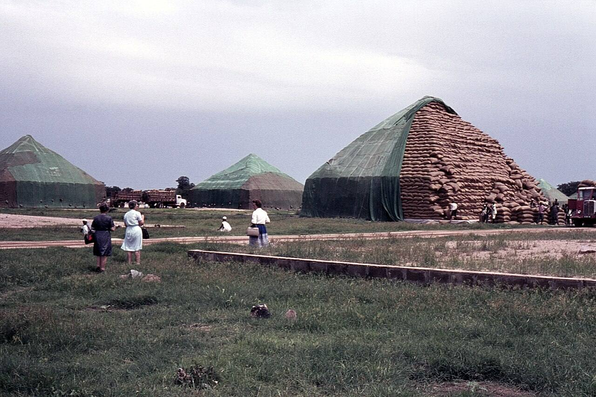
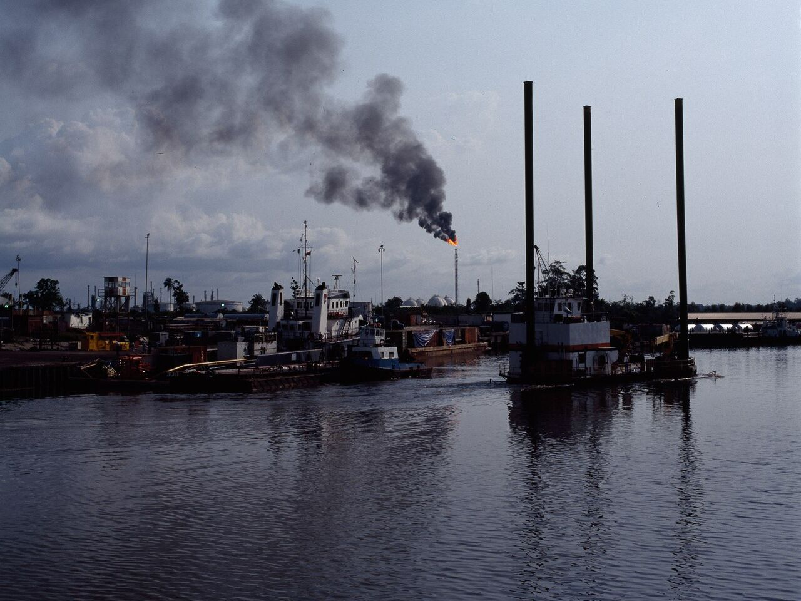

> *For she did not know that I gave her corn, and wine, and oil, and multiplied her silver and gold, which they prepared for Baal.* (Hosea 2:8)

Fifty years is long enough for a country to forget what it used to be. Nigerians under sixty have never held a naira that bought more than a dollar, never seen a groundnut pyramid, and never lived in a country that lent money to the World Bank. All three were ordinary facts of life in the Nigeria that staged FESTAC 77.

This article sets the two Nigerias side by side: the one that walked into the National Stadium on 15 January 1977, and the one that will mark the festival's fiftieth year in 2027. It uses the facts gathered in our longer account, [FESTAC 77: the four weeks Nigeria was leased to darkness](/articles/festac-77-nigeria-idolatry-repentance/), where every figure is sourced, and it asks the question that account asks: coincidence, or consequence? If you have seven minutes, [the film](https://www.youtube.com/watch?v=H_hnWUqkWno) tells the same story through one Lagos family.

*Cover: the groundnut pyramids of Kano in 1965 (David Pirmann, CC BY 2.0) and a gas flare at Nembe Creek in the Niger Delta in 1993 (Sara Leigh Lewis, CC BY-SA 4.0), both via Wikimedia Commons.*

## Nigeria before and after FESTAC 77 at a glance

| | Before FESTAC (1960–1977) | After FESTAC (1978–2026) |
| --- | --- | --- |
| **One naira bought** | $1.52 at its birth in 1973; $1.55 in January 1977; $1.80 by 1980 | 50 cents by 1988; 1 cent by 1999; 0.07 of a cent in June 2026 ($1 = ₦1,379) |
| **Nigeria and the IMF** | A lender: $120 million to the IMF's Oil Facility in 1974 | A borrower; structural adjustment from 1986 |
| **Nigeria and the World Bank** | A lender: $240 million in 1974 | One of its largest borrowers, owing more than $20 billion |
| **External debt** | About $150 million in 1960; about $3 billion in 1977, some 6 per cent of output | $18.6 billion by 1982; $36 billion by 2004; $54.5 billion in June 2026 |
| **Total public debt** | Nothing the country could not pay | ₦166.79 trillion in June 2026 |
| **What paid the bills** | Farms: agriculture was over six tenths of output and seven tenths of exports | Oil: 87 per cent of exports and three quarters of government revenue by 1988 |
| **Place in world farming** | Largest exporter of palm oil and palm kernels, about four tenths of world trade; largest exporter of groundnuts; second in cocoa | A net importer of palm oil and of food |
| **Income per head** | About $911 in 1980, the peak of the boom | About $262 in 1986; forty per cent lower in 2000 than in 1980 at purchasing power |
| **Who governed** | Soldiers, since the coups of 1966, after a civil war that killed more than a million | Soldiers again in 1983, 1985 and 1993; civilians since 1999 |
| **The Pentecostal church** | A small, despised minority meeting in classrooms | The largest congregations on earth |

Each line of that table is a story. Here they are, one by one.

## The naira: from a dollar and a half to seven hundredths of a cent

The naira was born on 1 January 1973 at about 66 kobo to the dollar, so that one naira was worth a dollar and fifty-two cents. It was pegged there and it held through the festival, and by 1980 it was stronger still, at 55 kobo to the dollar, or a dollar and eighty cents. A Nigerian student in London in those years was rich on his father's salary.

*Kano, 1965: the groundnut harvest stacked into pyramids as tall as houses, when Nigeria was the world's largest exporter of groundnuts. Photograph by David Pirmann, CC BY 2.0, via Wikimedia Commons.*

In 1986 the Babangida government took the IMF's structural adjustment programme and let the naira float. It went from under one naira to the dollar in May 1986 to two by the end of that year, four by 1988 and twenty-two by 1993. It traded above eighty on the street in the Abacha years, was 92 at the return to democracy in 1999, around 150 by 2010 and 305 in 2016, and after the float of 2023 it passed 1,500. The Central Bank's official rate on 30 June 2026 was ₦1,379 to the dollar. A naira that bought a dollar and a half when the festival fire was lit buys about seven hundredths of a cent today: it has lost more than 99.9 per cent of its value against the dollar.

## The debt: from lender to the world to ₦167 trillion

In 1974 the IMF, trying to carry the oil-importing countries through the first oil shock, borrowed from the countries that had the money. Nigeria was one of them. The permanent secretary Abubakar Alhaji signed for $120 million to the Fund's Oil Facility, and the same year Nigeria lent the World Bank $240 million. For most of 1973 to 1982 Nigeria stood on the creditor side of the IMF's books. General Gowon said that money was not the country's problem but how to spend it. On the eve of FESTAC the external debt was about $3 billion, some 6 per cent of national output.

The year after the festival the borrowing began. The $1 billion "jumbo loan" of January 1978, for the steel projects, was followed within the year by another of $750 million; the IMF's own historians date the change in Nigeria's borrowing from that year. By 1982 the external debt was $18.6 billion; by 1985, $19 billion and unpayable. By 2004 it was $36 billion, $31 billion of it to the Paris Club and most of that interest and penalties. In 2005 Ngozi Okonjo-Iweala negotiated an $18 billion write-off for $12 billion in cash and in April 2006 the books were cleared. Within fifteen years the country had borrowed its way back: $43 billion abroad in 2023, $54.5 billion in June 2026, and total public debt of ₦166.79 trillion. The country that lent the World Bank $240 million in 1974 now owes it more than $20 billion.

## The farms: from feeding the nation to importing its food

Nigeria at independence was an agricultural power. Farming produced more than six tenths of national output and about seven tenths of export earnings. Into the mid-1960s the country was the world's largest exporter of palm oil and palm kernels, with roughly four tenths of world trade, and the largest exporter of groundnuts; it was the second largest cocoa producer, behind Ghana. Each region paid its own way from its own crops, and the groundnut pyramids of Kano stood as the picture of the nation's wealth.

*Nembe Creek, 1993. By 1988 oil was 87 per cent of Nigeria's exports and three quarters of the government's revenue. Photograph by Sara Leigh Lewis, CC BY-SA 4.0, via Wikimedia Commons.*

Then oil paid for everything, and a currency held strong by oil dollars made imports cheap and the farmer's crop worthless. By 1988 oil was 87 per cent of exports and three quarters of the government's revenue, and the palm oil and groundnut trades had collapsed. The pyramids were gone by the end of the 1970s. The country that once supplied four tenths of the world's palm oil now imports it, and imports much of its food, in a land that fed itself and lent to the world within living memory.

## The people: a generation poorer than its parents

Measured in dollars of the day, output per Nigerian fell from about $911 in 1980 to about $262 in 1986. At purchasing power the average Nigerian was forty per cent poorer in 2000 than in 1980. That is the arithmetic behind a sentence every family knows: a generation grew up poorer than its parents in a country pumping two million barrels of oil a day. The scholarships that sent the sons of civil servants to London ended with the foreign exchange in 1986; their grandchildren now leave by any route they can, and "japa" has entered the language.

The spending that preceded the fall is part of the picture too, and it came before the festival. The Udoji awards of 1975 doubled public salaries with arrears. The same year the government ordered between sixteen and twenty million tonnes of cement for a port that could unload about a million tonnes a year, and four hundred ships sat at anchor off Lagos being paid to wait: the cement armada. From 1975 to 1977 the nation built the National Theatre at Iganmu and FESTAC Town and staged the festival itself, at a cost usually put at around $400 million. In 1977 Nigeria could afford it. That is what everyone said.

## The church: the one line that went up

Not every line on the chart runs downward. In 1977 the Pentecostal churches were a small and despised minority. Scholars of the period record that they organised to protest FESTAC "on the grounds that it was a plot from the devil to revitalize idol worship", and that they were ignored. Then came the revival of the 1980s, and the scattered classroom fellowships of 1977 became the largest congregations on earth. The same fifty years that emptied the treasury filled the churches. Whatever else the comparison shows, it shows where the people went when the money went.

## Coincidence or consequence?

Honesty is owed in both directions. Nigeria's troubles did not start in 1977: the first coups came in 1966, the civil war killed more than a million people between 1967 and 1970, and the rot was visible in the cement armada two years before the festival. FESTAC did not cause the oil glut of 1981. The economists have a complete explanation, and it is true: the resource curse, a currency held artificially strong, military governments that never needed to tax their people, loans taken at floating rates in boom years and repaid at double the interest in bust years, and corruption at every stage.

It is also exactly what the prophets said happens. Hosea watched a nation enjoy a boom, spend it on the gods of the land, and lose it: "Therefore will I return, and take away my corn in the time thereof, and my wine in the season thereof" (Hosea 2:9). Moses warned of the mechanism before Israel entered the land: "if thou do at all forget the LORD thy God, and walk after other gods... ye shall surely perish" (Deuteronomy 8:19). Haggai described the boom economy that cannot hold its money: "he that earneth wages earneth wages to put it into a bag with holes" (Haggai 1:6). In January and February 1977, at the height of the wealth God had given it, Nigeria's government lit a fire to Shango and poured libation to the ancestors in the nation's name, and paid for it with the oil money. The year after, the borrowing began. Four years after, the fall.

The Bible does not ask us to choose between the mechanism and the meaning. What this comparison shows is the shape of the fifty years. What it means, and what the church should do about it before 12 February 2027, is the subject of [the full account](/articles/festac-77-nigeria-idolatry-repentance/).

## Sources

The figures above are drawn from the sources listed in [FESTAC 77: the four weeks Nigeria was leased to darkness](/articles/festac-77-nigeria-idolatry-repentance/#sources): the Central Bank of Nigeria's exchange-rate history, the IMF's and the G24's accounts of Nigeria's borrowing, the Debt Management Office's June 2026 figures, Andrew Apter's study of the festival, and the press reports cited there. Scripture quotations are from the King James Version.

## Questions this article answers

### What was the naira worth before FESTAC 77?

One naira bought about a dollar and fifty-two cents when the currency was born in 1973, a dollar and fifty-five cents in January 1977, and a dollar and eighty cents by 1980. On 30 June 2026 a dollar cost ₦1,379, so the naira has lost more than 99.9 per cent of its value against the dollar in fifty years.

### Did Nigeria really lend money to the IMF and the World Bank?

Yes. In 1974 Nigeria lent the IMF $120 million through its Oil Facility and lent the World Bank $240 million, and it stood on the creditor side of the IMF's books for most of 1973 to 1982. Today it owes the World Bank more than $20 billion and the IMF has lent to it repeatedly.

### How much debt does Nigeria have now compared with 1977?

On the eve of FESTAC the external debt was about $3 billion, around 6 per cent of national output. In June 2026 the external debt was $54.5 billion and total public debt, domestic and foreign, was ₦166.79 trillion, even after the Paris Club wrote off $18 billion in 2005.

### Was Nigeria a farming country before oil?

Yes. Into the mid-1960s Nigeria was the world's largest exporter of palm oil, palm kernels and groundnuts and the second largest cocoa producer, with agriculture providing about seven tenths of export earnings. By 1988 oil was 87 per cent of exports and the country had become an importer of palm oil and food.

### Did FESTAC 77 cause Nigeria's decline?

The economists explain the fall by the resource curse, an overvalued currency, military spending without taxation and boom-time borrowing, and all of that is true. The decline began the year after the festival, and Scripture says a nation that dedicates its boom to other gods loses it (Hosea 2:8–9). The longer article weighs coincidence against consequence and says what the church should do.
